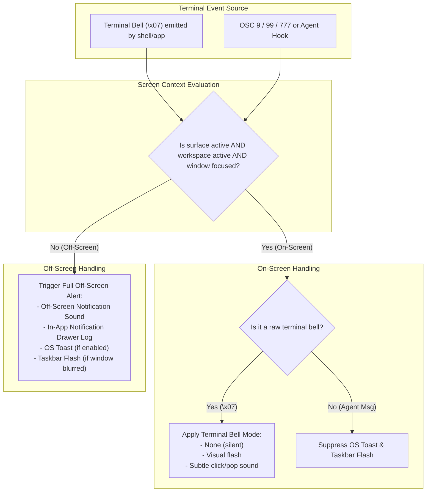

# Technical Specification: Terminal Bell and On-Screen vs Off-Screen Notification Separation

- **Feature / Bugfix Area**: Terminal Bell (`\x07`), Notification Architecture, Audio Feedback
- **Target Version**: 2.39.0
- **Authors**: wmux Engineering Team
- **Status**: Draft / Ready for Implementation

---

## 1. Executive Summary & Problem Statement

### 1.1 Context & Background
In issue #53, terminal bell handling was introduced as a fallback mechanism for CLI coding agents (such as Claude Code) that emit ASCII BEL (`\x07` or `\a`) when waiting for human input or permission. The implementation added an `onBell` handler in [`src/renderer/hooks/useTerminal.ts`](file:///D:/professional/code/learn/wmux/src/renderer/hooks/useTerminal.ts#L1387-L1401) that calls `window.wmux.notification.fire(...)`.

### 1.2 The Core Problem
Under everyday terminal usage, standard interactive shells and command-line programs routinely emit `\x07` to signal ordinary user input boundaries or minor errors:
- Pressing `Left Arrow` when the cursor is already at column 0 of a prompt line (in Bash/Zsh Readline or PowerShell PSReadLine).
- Pressing `Backspace` on an empty command line.
- Pressing `Tab` for autocomplete when no matching candidates exist.
- Typing unhandled keys or hitting limits in Vi/Vim normal mode.

Because `useTerminal.ts` currently treats every `terminal.onBell()` as a high-severity global notification event, wmux responds by:
1. Triggering an OS Windows desktop toast notification popup ([`notificationManager.showToast`](file:///D:/professional/code/learn/wmux/src/main/ipc-handlers.ts#L846)).
2. Flashing the Windows taskbar ([`notificationManager.flashTaskbar`](file:///D:/professional/code/learn/wmux/src/main/ipc-handlers.ts#L854)).
3. Playing the global loud notification audio chime via IPC `notification:play-sound` ([`playNotificationSound`](file:///D:/professional/code/learn/wmux/src/renderer/notification-sound.ts#L73)).
4. Adding an unread entry to the titlebar notification bell drawer ([`addNotification`](file:///D:/professional/code/learn/wmux/src/renderer/App.tsx#L223)).

### 1.3 User Impact
When actively typing in a terminal, accidentally pressing Left Arrow or Backspace triggers a loud chime, an OS toast overlaying the user's workspace, a flashing taskbar, and an in-app notification count. This constant barrage of false alarms irritates users, leading them to disable all sounds entirely in Settings (`notificationPrefs.sound = 'none'`).

Consequently, when an actual critical event occurs—such as a background agent in another workspace stopping for permission, a long-running build failing, or an off-screen surface needing attention—the user receives no sound and misses the event, defeating wmux's core value proposition ("never hunt for the one that's waiting on you").

---

## 2. Core Concepts: On-Screen vs Off-Screen

To permanently resolve this friction, wmux must establish a clean architectural separation between **On-Screen** interactions and **Off-Screen** notifications:

| Dimension | On-Screen (In-Focus / Active) | Off-Screen (Background / Inactive) |
| :--- | :--- | :--- |
| **Definition** | The event occurs in a surface that is currently **visible**, within the **currently active workspace**, while the wmux window **has OS focus**. | The event occurs in a background workspace, a hidden tab in a pane, or when the wmux window is **minimized / blurred**. |
| **User Presence** | The user is actively looking at or typing in this exact surface. | The user is looking elsewhere (another pane, another workspace, or another app like VS Code/browser). |
| **OS Desktop Toast** | **Never**. (User is already looking at the pane). | **Allowed** (if `notificationPrefs.toast` is enabled). |
| **Taskbar Flash** | **Never**. | **Allowed** (if window is unfocused and `taskbarFlash` enabled). |
| **Notification Drawer Badge** | Only for explicit agent task completion/approval messages, never for terminal bells (`\x07`). | **Logged** with surface/workspace jump link. |
| **Audio Feedback** | **On-Screen Sound Profile**: Subtle click/pop, visual flash, or silenced; independent of off-screen sound. | **Off-Screen Alert Sound Profile**: Chime, Ping, Marimba, or Custom high-priority sound. |

---

## 3. User Stories

### Story 1: Smooth Interactive Shell Typing
> *As a developer* working in PowerShell or Bash inside wmux,  
> *When I* press the Left Arrow at the start of the line or hit Backspace on an empty line,  
> *I want* the terminal to either remain silent or give a subtle audible/visual cue,  
> *So that* I do not get startled by loud system chimes or interrupted by OS toasts while typing.

### Story 2: Distinct Off-Screen Agent Alerting
> *As an AI developer* orchestrating Claude Code or Grok across 4 workspaces,  
> *When* an agent in Workspace 3 finishes a run or halts for tool permission while I am working in Workspace 1,  
> *I want* a distinct, clear off-screen audio chime and notification badge,  
> *So that* I immediately know an off-screen task requires my attention without getting distracted while typing in Workspace 1.

### Story 3: Independent Sound & Bell Configuration
> *As a user*,  
> *I want* to configure the on-screen terminal bell behavior (audible subtle beep, visual flash, or none) independently from the off-screen notification sound,  
> *So that* I can keep notifications enabled for background agents without suffering terminal bell noise.

---

## 4. Architectural Analysis & Proposed Design



### 4.1 Changes in `src/renderer/hooks/useTerminal.ts`
1. **Context Check Helper**:
   Evaluate whether the surface is currently on-screen:
   ```typescript
   function isSurfaceOnScreen(surfaceId: string | undefined): boolean {
     if (!surfaceId) return false;
     if (!document.hasFocus()) return false;
     const state = useStore.getState();
     const activeWs = state.workspaces.find((w) => w.id === state.activeWorkspaceId);
     if (!activeWs) return false;
     // Check if surfaceId belongs to the active workspace split tree and is currently active in its pane
     return isSurfaceActiveInWorkspace(activeWs.root, surfaceId);
   }
   ```
2. **Refactored `terminal.onBell()`**:
   - If `isSurfaceOnScreen(surfaceId)` is true:
     - Check `terminalPrefs.bellStyle` (`'none' | 'audible' | 'visual'`).
     - If `'visual'`: trigger a CSS flash on `.terminal-pane__container` (standard visual bell).
     - If `'audible'`: play the configured on-screen subtle bell sound (e.g. `'pop'` or a short 800Hz beep synthesized with Web Audio API).
     - **Do NOT** call `window.wmux.notification.fire()`.
   - If `isSurfaceOnScreen(surfaceId)` is false (the terminal is in a background workspace or background tab):
     - Check `notificationPrefs.bellNotifyBackground` (default `true`).
     - Fire a notification with contextual text: e.g. `t('terminal.bellBackground', 'Terminal bell in {workspace}')`.

### 4.2 Changes in `src/renderer/store/settings-slice.ts`
1. Extend `TerminalPrefs`:
   ```typescript
   export interface TerminalPrefs {
     // ... existing fields ...
     /** Terminal bell style for on-screen/focused terminal: 'none' | 'audible' | 'visual' */
     bellStyle: 'none' | 'audible' | 'visual';
     /** Sound profile for on-screen terminal bell: 'subtle' | 'system' | 'none' */
     bellSound: 'subtle' | 'pop' | 'none';
   }
   ```
2. Extend `NotificationPrefs`:
   ```typescript
   export interface NotificationPrefs {
     // ... existing fields ...
     /** Off-screen sound for background workspaces/agents */
     sound: 'default' | 'chime' | 'ping' | 'marimba' | 'pop' | 'custom' | 'none';
     /** On-screen in-app notification sound */
     onScreenSound: 'pop' | 'subtle' | 'none';
     /** Whether terminal bell in background surfaces triggers off-screen notifications */
     bellNotifyBackground: boolean;
   }
   ```

### 4.3 Changes in `src/renderer/notification-sound.ts`
- Separate audio playback channels:
  - `playNotificationSound(context: 'onscreen' | 'offscreen')`
  - When `context === 'onscreen'`, respect `notificationPrefs.onScreenSound` (defaults to `'pop'`, lightweight and non-intrusive).
  - When `context === 'offscreen'`, play `notificationPrefs.sound` (defaults to `'default'` chime).
- Add synthetic Web Audio API fallback for terminal bell beep (`playSubtleBell()`), avoiding asset load delays.

### 4.4 Changes in `src/main/ipc-handlers.ts`
- Update `IPC_CHANNELS.NOTIFICATION_FIRE` payload to carry `context?: 'onscreen' | 'offscreen'` or `isBell?: boolean`.
- Suppress `notificationManager.showToast` if the originating window is already focused and the notification is flagged as `onscreen`.

---

## 5. Acceptance Criteria

- [ ] **AC-1 (No Toast/Flash on Typing)**: Pressing `Left Arrow` at column 0 or `Backspace` on an empty prompt line in Bash, Zsh, or PowerShell in a focused terminal never shows an OS toast and never flashes the Windows taskbar.
- [ ] **AC-2 (No Drawer Clutter on Typing)**: Normal shell bells in a focused terminal never add entries to the title bar notification bell list.
- [ ] **AC-3 (Configurable On-Screen Bell)**: Settings > Terminal contains a "Terminal Bell" configuration option with options: `Audible (Subtle)`, `Visual (Flash)`, and `Silent (None)`.
- [ ] **AC-4 (Reliable Off-Screen Alerting)**: When a terminal or agent in an inactive workspace or background tab emits a bell or completes a turn, a proper off-screen notification fires (sound chime, taskbar flash if window is unfocused, and in-app notification panel entry).
- [ ] **AC-5 (Independent Sound Settings)**: Setting on-screen bell to `None` does NOT disable off-screen agent notifications. Setting off-screen sound to `Chime` does not cause typing in the active pane to chime.
- [ ] **AC-6 (Visual Bell Animation)**: When `bellStyle` is set to `visual`, an on-screen bell smoothly flashes the terminal pane border/background without audio.

---

## 6. Implementation Checklist & File Touched

1. [`src/renderer/store/settings-slice.ts`](file:///D:/professional/code/learn/wmux/src/renderer/store/settings-slice.ts):
   - Add `bellStyle` and `bellSound` to `TerminalPrefs` and defaults.
   - Add `onScreenSound` and `bellNotifyBackground` to `NotificationPrefs` and defaults.
2. [`src/renderer/hooks/useTerminal.ts`](file:///D:/professional/code/learn/wmux/src/renderer/hooks/useTerminal.ts):
   - Implement `isSurfaceOnScreen` check.
   - Separate on-screen visual/subtle bell from background notification fire in `terminal.onBell`.
3. [`src/renderer/notification-sound.ts`](file:///D:/professional/code/learn/wmux/src/renderer/notification-sound.ts):
   - Implement distinct on-screen subtle bell sound / Web Audio generator.
   - Support `context` parameter for sound playback.
4. [`src/renderer/components/Settings/TerminalSettings.tsx`](file:///D:/professional/code/learn/wmux/src/renderer/components/Settings/TerminalSettings.tsx):
   - Add UI controls for Terminal Bell mode (`Audible`, `Visual`, `Silent`).
5. [`src/renderer/components/Settings/NotificationSettings.tsx`](file:///D:/professional/code/learn/wmux/src/renderer/components/Settings/NotificationSettings.tsx):
   - Add UI controls separating On-Screen vs Off-Screen notification sounds.
6. [`src/renderer/styles/terminal.css`](file:///D:/professional/code/learn/wmux/src/renderer/styles/terminal.css):
   - Add `.terminal-pane--bell-flash` keyframe animation for visual bell mode.
7. [`tests/terminal-bell.test.ts`](file:///D:/professional/code/learn/wmux/tests/):
   - Add unit tests validating that focused on-screen bells do not dispatch `notification:fire`.
