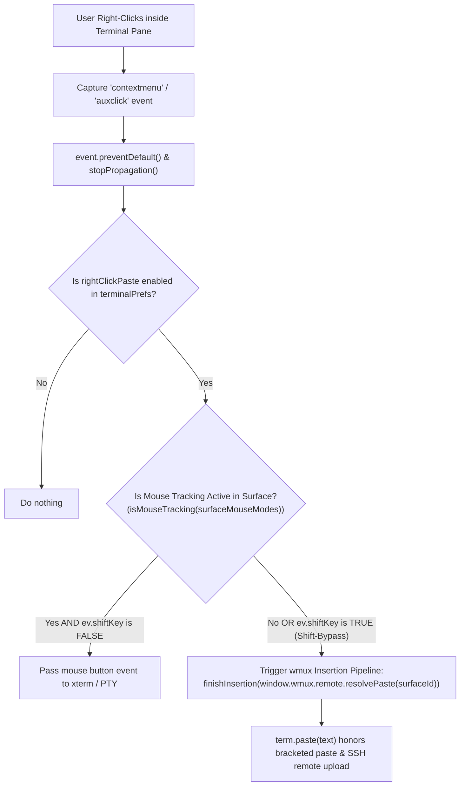

# Technical Specification: Native Right-Click Paste in Terminal

- **Feature Area**: Terminal Interaction, Mouse Input, Clipboard Management
- **Target Version**: 2.39.0
- **Authors**: wmux Engineering Team
- **Status**: Draft / Ready for Implementation

---

## 1. Executive Summary & Problem Statement

### 1.1 Context & Background
In terminal environments across Linux (Ubuntu Gnome Terminal, xterm, Konsole), macOS (iTerm2), and modern Windows consoles (Windows Terminal, PuTTY, ConEmu, Git Bash / Mintty), right-clicking inside the terminal viewport is the standard, universal gesture for pasting text from the system clipboard.

In wmux, terminal panes are rendered using xterm.js mounted in a `<div ref={terminalRef} className="terminal-pane__container" />` inside [`src/renderer/components/Terminal/TerminalPane.tsx`](file:///D:/professional/code/learn/wmux/src/renderer/components/Terminal/TerminalPane.tsx#L131).

### 1.2 The Problem
Currently, wmux does not attach any `contextmenu` or secondary mouse button handler to the terminal container:
- Right-clicking anywhere within the terminal viewport does nothing.
- The browser context menu is absent (or suppressed), and no paste action is triggered.
- Users coming from Linux, Ubuntu, or Windows Terminal instinctively right-click to paste snippets, commands, or URLs, but find the gesture completely inert.
- Users are forced to rely exclusively on `Ctrl+V` or `Ctrl+Shift+V` keyboard shortcuts for every clipboard operation.

### 1.3 Solution Overview
Implement native right-click paste support in wmux terminal panes:
1. Intercept `contextmenu` / secondary mouse clicks on the terminal container.
2. Route the action directly through wmux's existing, battle-tested paste pipeline (`window.wmux.remote.resolvePaste(surfaceId)` -> [`applyInsertion`](file:///D:/professional/code/learn/wmux/src/renderer/hooks/useTerminal.ts#L199-L220)), preserving bracketed paste mode, clipboard image upload, and remote SSH insertion.
3. Respect terminal **Mouse Tracking Mode**: when an interactive full-screen application (such as `vim`, `nano`, `tmux`, `htop`, or `micro`) has enabled terminal mouse tracking, allow the application to receive right-click mouse events normally.
4. Support the universal terminal standard **Shift-bypass**: pressing `Shift + Right Click` forces a clipboard paste even inside a mouse-tracking application.
5. Provide a toggle in **Settings > Terminal** (`rightClickPaste`, enabled by default) so users can customize mouse behavior.

---

## 2. Universal Terminal Interaction Standards

| Environment | Default Right-Click Behavior | Behavior with Active Text Selection | When App Has Mouse Tracking On |
| :--- | :--- | :--- | :--- |
| **Ubuntu / GNOME Terminal** | Paste clipboard | Paste or context menu | Passed to app (Shift+RightClick pastes) |
| **Windows Terminal** | Paste clipboard | Copy selection (or paste) | Passed to app (Shift+RightClick pastes) |
| **PuTTY / Mintty** | Paste clipboard | Paste clipboard | Passed to app |
| **wmux (Current)** | **No-op (Dead)** | **No-op (Dead)** | Dead |
| **wmux (Proposed)** | **Paste clipboard** | **Paste clipboard** (or copy if configured) | **Passed to app (Shift+RightClick pastes)** |

---

## 3. User Stories

### Story 1: Fast & Intuitive Command Pasting
> *As a software engineer* working across Windows and Linux environments,  
> *When I* copy a command from a browser or documentation and right-click in my wmux terminal,  
> *I want* the clipboard text to immediately paste at the prompt,  
> *So that* I have a frictionless workflow matching my muscle memory from Ubuntu and Windows Terminal.

### Story 2: Preserved Mouse Support for Vim/Tmux
> *As a developer* using Vim or Tmux inside a wmux pane,  
> *When* Vim has mouse mode enabled (`:set mouse=a`),  
> *I want* right-clicking to interact with Vim (e.g. open visual context or move cursor) rather than pasting accidentally,  
> *Unless* I hold down `Shift` while right-clicking to explicitly paste from my host clipboard.

### Story 3: User Preference Configuration
> *As a user* who prefers keeping right-click inert or reserved for a future context menu,  
> *I want* a toggle under Settings > Terminal to enable or disable Right-Click Paste,  
> *So that* the app adapts to my specific ergonomic preferences.

---

## 4. Technical Architecture & Implementation Design



### 4.1 Event Interception & Element Target
In [`src/renderer/hooks/useTerminal.ts`](file:///D:/professional/code/learn/wmux/src/renderer/hooks/useTerminal.ts):
Attach a capture or bubbling `contextmenu` listener on `terminalRef.current`:

```typescript
const onContextMenu = (ev: MouseEvent) => {
  const prefs = useStore.getState().terminalPrefs;
  if (!prefs.rightClickPaste) return;

  // Check if an application has claimed terminal mouse tracking (Vim, Tmux, etc.)
  const mouseMode = surfaceMouseModes.get(surfaceId ?? '');
  const appMouseTracking = isMouseTracking(mouseMode);

  // If application is tracking mouse and Shift is NOT pressed, pass event through to xterm
  if (appMouseTracking && !ev.shiftKey) {
    return;
  }

  // Prevent browser default context menu
  ev.preventDefault();
  ev.stopPropagation();

  // Execute paste via the authoritative wmux insertion pipeline
  if (xtermRef.current && ptyIdRef.current) {
    finishInsertion(window.wmux.remote.resolvePaste(surfaceId ?? ''));
  }
};

const host = terminalRef.current;
host.addEventListener('contextmenu', onContextMenu);
cleanupFnsRef.current.push(() => {
  host.removeEventListener('contextmenu', onContextMenu);
});
```

### 4.2 Reusing the Canonical Insertion Pipeline
wmux already contains a centralized insertion handler:
- Function: [`finishInsertion`](file:///D:/professional/code/learn/wmux/src/renderer/hooks/useTerminal.ts#L858-L864) calling [`applyInsertion`](file:///D:/professional/code/learn/wmux/src/renderer/hooks/useTerminal.ts#L199-L220).
- `window.wmux.remote.resolvePaste(surfaceId)`:
  - Automatically queries the clipboard for text, image, or file paths.
  - Automatically handles remote SSH SCP upload if the pane is attached to an SSH session.
  - Returns sanitized, properly escaped text.
- `term.paste(result.text)`:
  - Invokes xterm.js's native `paste()` method.
  - Automatically wraps text in `\x1b[200~` ... `\x1b[201~` when Bracketed Paste Mode (`\x1b[?2004h`) is active, preventing accidental command execution of multi-line strings.
  - Keeps focus on the terminal: `term.focus()`.

### 4.3 Settings & State Management
In [`src/renderer/store/settings-slice.ts`](file:///D:/professional/code/learn/wmux/src/renderer/store/settings-slice.ts):
Extend `TerminalPrefs`:
```typescript
export interface TerminalPrefs {
  // ... existing fields ...
  /** Right-click inside terminal viewport pastes clipboard content (default true). */
  rightClickPaste: boolean;
}

export const DEFAULT_TERMINAL_PREFS: TerminalPrefs = {
  // ... existing defaults ...
  rightClickPaste: true,
};
```

In [`src/renderer/components/Settings/TerminalSettings.tsx`](file:///D:/professional/code/learn/wmux/src/renderer/components/Settings/TerminalSettings.tsx):
Add setting control under mouse/interaction section:
```tsx
<div className="settings-row">
  <label className="settings-label">{t('settings.terminalPanel.rightClickPaste', 'Right-click to paste')}</label>
  <input
    type="checkbox"
    className="settings-toggle"
    checked={terminalPrefs.rightClickPaste}
    onChange={(e) => setTerminalPrefs({ rightClickPaste: e.target.checked })}
  />
</div>
<p className="settings-hint">
  {t(
    'settings.terminalPanel.rightClickPasteHint',
    'Paste clipboard text into the terminal when right-clicking, matching Ubuntu and Windows Terminal. In mouse-aware apps (Vim, Tmux), hold Shift+Right-Click to force paste.',
  )}
</p>
```

---

## 5. Edge Cases & Handling Strategy

1. **Multi-line Text Pasting**:
   - `term.paste()` honors bracketed paste mode so multi-line text is pasted safely without auto-executing newline commands.
2. **Remote SSH Sessions**:
   - `resolvePaste` detects when a surface is inside an SSH session and handles remote file uploads via SCP. Right-click paste seamlessly benefits from this.
3. **Empty Clipboard**:
   - If clipboard contains no text/data, `resolvePaste` returns empty text and `applyInsertion` exits cleanly without error or visual glitch.
4. **Mouse Tracking in TUI Applications**:
   - When Vim/Tmux is active and mouse tracking is enabled, a bare right click is dispatched as an SGR mouse event to the terminal application.
   - Holding `Shift` bypasses the application and executes the clipboard paste.
5. **Selection State**:
   - If user has selected text in xterm, right-click pastes at cursor position (and can optionally clear selection).

---

## 6. Acceptance Criteria

- [ ] **AC-1 (Basic Right-Click Paste)**: Right-clicking anywhere within a terminal pane in Bash, PowerShell, or CMD immediately pastes the current clipboard text.
- [ ] **AC-2 (Focus Restoration)**: Right-clicking to paste ensures the clicked terminal pane receives active keyboard focus immediately.
- [ ] **AC-3 (Bracketed Paste Compatibility)**: When pasting multi-line text into a shell that supports bracketed paste, the lines are pasted as a single block without immediate execution.
- [ ] **AC-4 (Mouse Tracking Respect)**: When running a mouse-tracking application (e.g. `vim` with `:set mouse=a`), bare right-click does not trigger wmux paste and is delivered to the app.
- [ ] **AC-5 (Shift-Bypass)**: In a mouse-tracking application, `Shift + Right Click` forces host clipboard paste.
- [ ] **AC-6 (Settings Toggle)**: Toggling "Right-click to paste" OFF in Settings > Terminal disables right-click paste immediately.
- [ ] **AC-7 (Internationalization)**: Settings label and description keys are added to `src/renderer/i18n/locales/en.ts` and core dictionary.

---

## 7. Implementation Checklist & File Touched

1. [`src/renderer/store/settings-slice.ts`](file:///D:/professional/code/learn/wmux/src/renderer/store/settings-slice.ts):
   - Add `rightClickPaste: boolean` to `TerminalPrefs` and `DEFAULT_TERMINAL_PREFS`.
2. [`src/renderer/hooks/useTerminal.ts`](file:///D:/professional/code/learn/wmux/src/renderer/hooks/useTerminal.ts):
   - Add `contextmenu` listener on `terminalRef.current`.
   - Implement mouse-tracking and `Shift` check.
   - Invoke `finishInsertion(window.wmux.remote.resolvePaste(surfaceId ?? ''))`.
3. [`src/renderer/components/Settings/TerminalSettings.tsx`](file:///D:/professional/code/learn/wmux/src/renderer/components/Settings/TerminalSettings.tsx):
   - Add `rightClickPaste` toggle and explanation hint in the UI.
4. [`src/renderer/i18n/locales/en.ts`](file:///D:/professional/code/learn/wmux/src/renderer/i18n/locales/en.ts):
   - Add translation strings for `settings.terminalPanel.rightClickPaste` and `settings.terminalPanel.rightClickPasteHint`.
5. [`tests/terminal-right-click-paste.test.ts`](file:///D:/professional/code/learn/wmux/tests/):
   - Add unit test verifying that right-click invokes the insertion pipeline when enabled and obeys the mouse tracking gate.
